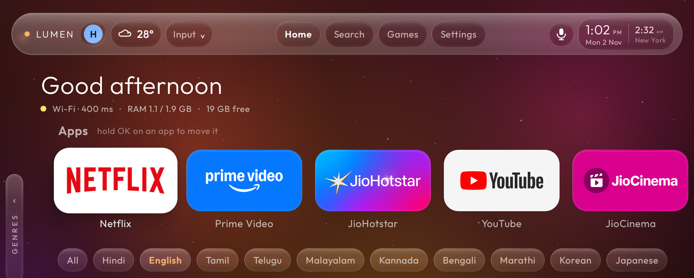
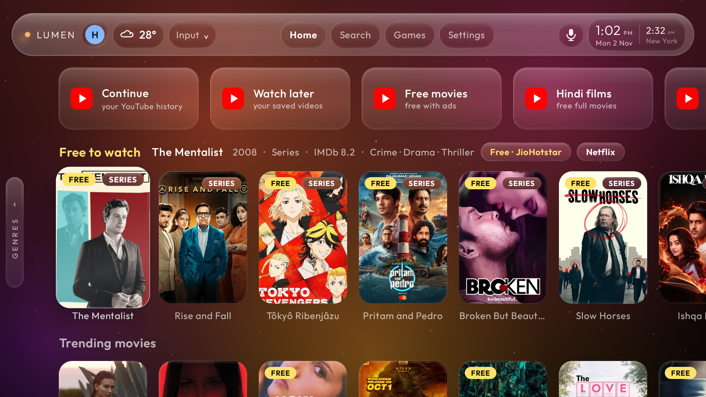
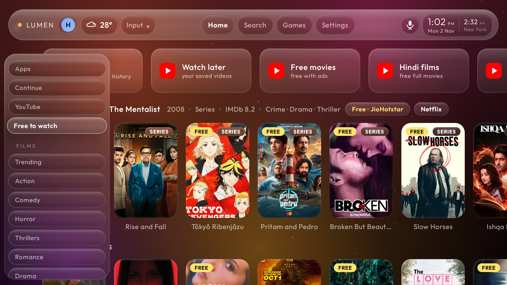
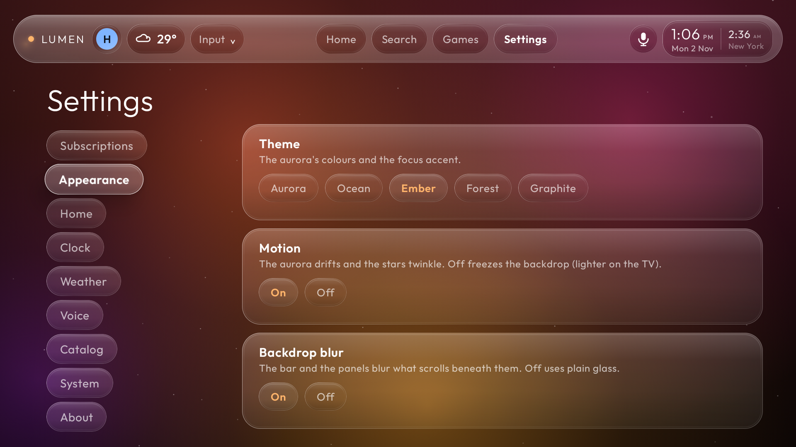
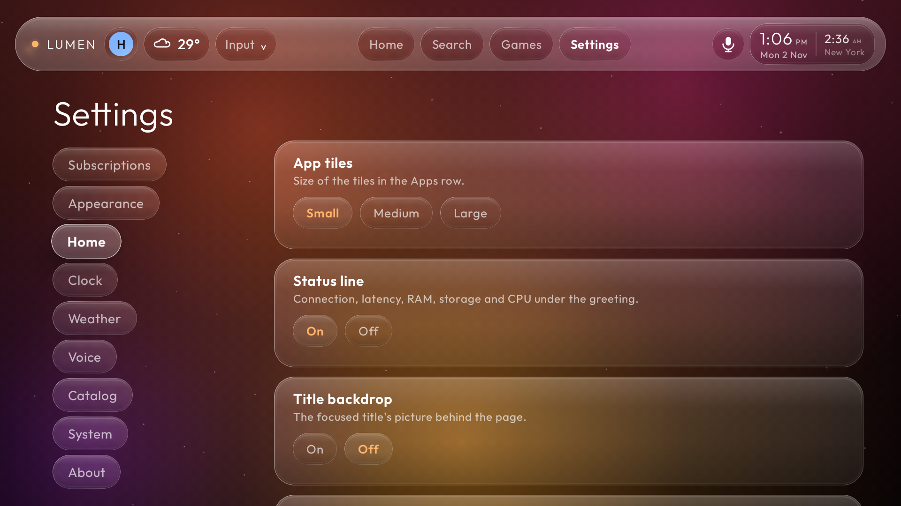

# Lumen — a glass launcher for Android TV / Google TV

Lumen replaces the Google TV home screen with a calmer one: frosted-glass surfaces over a
slowly drifting aurora, your apps up front, and films and series from the streaming apps you
already have, sorted by genre and language. Press OK on any title and its trailer plays with
the details floating over it. Everything runs on the TV itself; there is no account, no
server and no analytics.



| Rows, with the focused title described beside the row name | The genre menu (LEFT from any row) |
|---|---|
|  |  |

| Settings: themes, motion, blur | Settings: the home screen |
|---|---|
|  |  |

---

## Tested on

| | |
|---|---|
| TV | **TCL Smart TV Pro**, device G09 (G09_4K_GB) |
| Chip | Amlogic T5M, 2 GB RAM, 4K panel rendered at 1080p |
| OS | **Android TV 12 (API 31) with Google TV** |
| Lumen | 0.6.1, November 2026 |

Lumen needs Android 9 (API 28) or newer and an Android TV / Google TV device. It has only been
tested on the TV above. Other TCL, Sony, Hisense, Chromecast and Shield devices should work, but
the Home-button handling and screen-off behaviour depend on the manufacturer; reports welcome.

---

## What it does

**Home**
- Your apps in a row of glass tiles. Hold OK on a tile, then LEFT / RIGHT to move it; OK drops it.
- A status line: Wi-Fi name and address, internet latency, **whether the remote's microphone
  is connected**, RAM, storage and a CPU graph.
- Language chips (All, Hindi, English, Tamil, Telugu, Malayalam, Kannada, Bengali, Marathi,
  Korean, Japanese) that filter every row.
- **Continue**: titles you opened from Lumen.
- **YouTube**: opens YouTube's own History, Watch later, free-with-ads films and free-film searches.
- Endless rows from the streaming apps installed on the TV: Free to watch, Trending films and
  series, and genre rows (Action, Comedy, Horror, Thrillers, Romance, Drama, Sci-Fi, Animation,
  Documentaries; Drama, Crime, Comedy, Thriller and Action series). Rows load more as you scroll.
- **Genre menu**: press LEFT from any row; a folded "GENRES" handle opens into a list of every
  section. OK or RIGHT jumps there, Back closes it.

**Titles and trailers**
- OK on a title plays its trailer in the YouTube app with Lumen's details on a see-through card
  over the video: name, year, IMDb rating, genres, languages, story, and the apps that have it.
- While the card shows, LEFT / RIGHT pick an app and OK opens the title in it, at the title
  where the app allows it. Back returns to Lumen in one press.

**Top bar**
- Profiles (each keeps its own app order, language, subscriptions and second clock).
- Weather with a 7-day forecast. Input switching for HDMI and AV, with a Screen off entry.
- Search (Lumen's own: apps plus titles across your apps), and a mic button that opens
  Google Assistant by default.
- A clock with a calendar and an optional second city.

**Around the TV**
- **Screensaver**: the aurora, a large clock, a month calendar, the weather and your next
  subscription renewal.
- **Floating clock** over other apps and video, in any corner.
- **Consoles and players**: the Input menu names what is on each HDMI port (for example
  "XBOX · HDMI 3"), and the TV switches to a device when it turns on (Settings → System).
- **Now playing**: whatever app is playing media shows on Home with play / pause, next, open
  and stop.
- **Screen off with sound on**: hold Home for one second, anywhere, including inside YouTube.
  The screen goes black and the audio keeps playing; any key brings the picture back.
- **Subscriptions tracker** (in Settings): what you pay, per month and per year, and when each
  renews.

**Settings**

| Section | What you can change |
|---|---|
| Subscriptions | the tracker |
| Appearance | theme (Aurora, Ocean, Ember, Forest, Graphite), motion, backdrop blur |
| Home | app tile size, status line, title backdrop, YouTube row, film rows, series rows |
| Clock | 12 / 24-hour, second city, floating clock position and size |
| Weather | °C / °F, re-detect location |
| Voice | what the mic opens: Google Assistant, Lumen's own commands, or an installed Claude / Gemini app |
| Catalog | country for the catalog, a TMDB key for trailers, clear the cache |
| System | screensaver timer and preview, Home-button status, now-playing access, Screen off, Android settings |

### What it cannot do

Being a sideloaded launcher has limits that no code can get around:

- **Other apps' "continue watching" is not readable.** Android keeps it in a store only the
  built-in launcher may read. Lumen's Continue row is what you opened through Lumen.
- **The Home button still goes to Google TV first.** Lumen comes forward about half a second
  later, through an accessibility service. Google TV stays installed; disabling it breaks the
  Home button on many TVs.
- **YouTube does not play in the background.** The YouTube TV app pauses when anything else
  comes in front, even with Premium. That is why screen off works by laying a black window over
  YouTube rather than leaving it.
- **Screen off keeps the backlight at its lowest**, because apps cannot switch the panel off.
- **YouTube's own in-video ads** are not blocked by DNS ad blocking.

### If voice says "I didn't catch that"

On a Google TV remote the buttons work over infrared without any pairing, but the **microphone
is a Bluetooth link**. When that link is down, every voice feature on the TV, Google
Assistant included, hears silence and reports that it did not catch anything, while every
button keeps working. It looks exactly like a software fault and is not one. That cost a
day here.

Lumen's status line says **Remote mic connected** or **Remote mic not connected**. If it is
not connected, pair the remote again in the TV's own Settings → Remotes & accessories (on
most TCL remotes: hold Back and Home together until the light blinks, then confirm on
screen). Lumen's voice screen also refuses to listen and tells you this when the link is
down, instead of pretending to listen.

How Lumen listens: its own screen first, through Google's recognizer. If that returns no
words, the same attempt continues on Google's voice-input bar, and Lumen remembers which of
the two works on your TV.

---

## Install

You need a computer with [Android platform-tools](https://developer.android.com/tools/releases/platform-tools)
(`adb`) and the TV on the same network. The commands below assume `adb` is on your PATH.

### 1. Turn on network debugging on the TV

1. Settings → System → About → scroll to **Android TV OS build** and press OK seven times.
2. Settings → System → Developer options → turn on **USB debugging**. On most TVs this also
   enables network ADB on port 5555. (Some devices call it **Network debugging** or
   **Wireless debugging**; turn that on instead.)
3. Find the TV's IP address under Settings → Network & Internet → your network.

### 2. Connect and install

Download `lumen-<version>.apk` from the [Releases](../../releases) page, then:

```
adb connect <tv-ip>:5555
adb install -r lumen-0.6.1.apk
```

The first `adb connect` shows a prompt on the TV. Choose **Always allow from this computer**.

Lumen now appears in your apps list. Open it once.

### 3. Permissions

Lumen works without any of these, with the matching feature switched off. Each line is a
one-time command from your computer. None of them give Lumen network or account access; they
are all on-device switches.

| For | Permission | Command |
|---|---|---|
| Home button lands on Lumen, trailer controls, hold-Home screen off | Accessibility service *Lumen Home button* | see below |
| Keeping that service on after updates and reboots | Write secure settings | `adb shell pm grant org.idktech.lumen android.permission.WRITE_SECURE_SETTINGS` |
| Floating clock | Display over other apps | `adb shell appops set org.idktech.lumen SYSTEM_ALERT_WINDOW allow` |
| Now playing on Home | Notification access | `adb shell cmd notification allow_listener org.idktech.lumen/org.idktech.lumen.media.NowPlayingListener` |
| Setting the screensaver timer from Lumen | Modify system settings | `adb shell appops set org.idktech.lumen WRITE_SETTINGS allow` |
| Lumen's own voice commands (optional) | Microphone | `adb shell pm grant org.idktech.lumen android.permission.RECORD_AUDIO` |
| Status line: is the remote's mic connected | Bluetooth (nearby devices) | asked on the TV at first start, or Settings → System → *Status line details* |
| Status line: the Wi-Fi network's name | Location (Android ties the Wi-Fi name to it) | asked on the TV at first start; nothing leaves the TV |

**Accessibility service.** The easiest way is on the TV: Settings → Accessibility → **Lumen
Home button** → on. Or from the computer:

```
adb shell settings put secure enabled_accessibility_services org.idktech.lumen/org.idktech.lumen.HomeRedirectService
adb shell settings put secure accessibility_enabled 1
```

That command *replaces* the list of enabled accessibility services. If you use another one
(TalkBack, for example), turn Lumen on from the TV's Settings instead.

The service only watches which app is in front and listens to the remote's keys. It does not
read the screen (`canRetrieveWindowContent` is off). It uses keys for four things: bringing
Lumen forward when Google TV's home opens, Back and LEFT / RIGHT / OK on the trailer card, and
holding Home for screen off. Every other key passes straight through.

With **Write secure settings** granted, Lumen switches this service back on by itself whenever
Android turns it off, which happens after some updates and reboots.

### 4. Optional extras

**Screensaver.** Settings → System → Screen saver → **Lumen**, or:

```
adb shell settings put secure screensaver_components org.idktech.lumen/.dream.LumenDream
```

**Better trailers.** Lumen finds trailers on YouTube by itself. With a free
[TMDB](https://www.themoviedb.org/settings/api) key it asks The Movie Database first, which
gives the official trailer more often. Type the key in Lumen under Settings → Catalog, or:

```
adb shell am start -n org.idktech.lumen/.MainActivity --es lumen.tmdb_key <your-key>
```

The key stays in Lumen's private storage on the TV.

**Ad blocking for the whole TV, with nothing installed.** Android TV 12 has Private DNS built
in. Pointing it at [AdGuard DNS](https://adguard-dns.io/) blocks ad and tracking servers for
every app (not YouTube's in-video ads):

```
adb shell settings put global private_dns_specifier dns.adguard-dns.com
adb shell settings put global private_dns_mode hostname
```

To undo: `adb shell settings put global private_dns_mode opportunistic`.

---

## Using it

| Press | Does |
|---|---|
| OK on an app | opens it |
| Hold OK on an app | move mode: LEFT / RIGHT move it, OK drops it |
| OK on a title | plays its trailer with the details card |
| LEFT / RIGHT, OK on the trailer card | pick an app, open the title there |
| Back on the trailer | back to Lumen, where you were |
| LEFT at the start of a row | opens the genre menu; OK or RIGHT jumps, Back closes |
| Home while Lumen is in front | glides to the top of the home screen (from an app, the first press brings Lumen back where it was, the second goes to the top) |
| Hold Home for 1 s | screen off, sound on; any key wakes |
| Mic in the top bar | Google Assistant (or what you chose under Settings → Voice) |

---

## Performance

Measured on the TV above with `dumpsys meminfo`, `top` and `am start -W`.

| | Lumen 0.6.1 | Google TV home |
|---|---|---|
| Memory (PSS) | ~122 MB | ~136 MB |
| CPU, idle on the home screen | ~3% of one core | ~0% |
| CPU, while browsing | ~60% of one core | not measured |
| Cold start | ~1.9 s | always running |

The cost is the live glass. Every glass tile redraws the aurora behind it, so the aurora moves
only while you use the remote, at about 9 frames a second, and rests 20 seconds after the last
key. Settings → Appearance → **Motion off** makes browsing cheaper. **Backdrop blur off** uses
plain glass on the bar and panels.

Google TV's home stays loaded in the background, because the Home button opens it for a moment
before Lumen comes forward.

---

## Privacy and network

Lumen has no account, no analytics and no server of its own. It talks to these services, and
nothing else:

| Service | Why | When |
|---|---|---|
| [JustWatch](https://www.justwatch.com/) (`apis.justwatch.com`) | the catalog: titles, posters, which app has them | rows load, cached 6 hours |
| JustWatch's image CDN | posters | as rows show |
| YouTube (`youtube.com`) | finding a title's trailer, and playing it in the YouTube app | OK on a title |
| [TMDB](https://www.themoviedb.org/) | trailers, only if you set a key | OK on a title |
| [ip-api.com](https://ip-api.com/) | your city, for the weather (plain HTTP on their free tier) | once, then remembered |
| [Open-Meteo](https://open-meteo.com/) | the forecast | every 30 minutes |
| `connectivitycheck.gstatic.com` | the online dot and latency | every 10 seconds while Home is open |

Your profiles, app order, subscriptions, history and keys stay in Lumen's private storage on
the TV.

---

## Uninstall

```
adb uninstall org.idktech.lumen
```

Android removes the accessibility service and every permission with the app. If you changed
Private DNS or the screensaver, set them back in the TV's Settings.

---

## Build from source

Requirements: **JDK 17** (Gradle 8.9 does not run on newer JDKs) and the Android SDK with
platform 35 (`ANDROID_HOME`, or `sdk.dir` in `local.properties`).

```
./gradlew assembleRelease
adb install -r app/build/outputs/apk/release/app-release.apk
```

Or with the helper scripts: `bash build.sh`, then `bash install.sh <tv-ip>`.

**Signing.** Without a key the release build is signed with the debug key, which is fine for
your own TV. To sign with your own key, create a `keystore.properties` outside the repository
with `storeFile`, `storePassword`, `keyAlias` and `keyPassword`, and point
`LUMEN_KEYSTORE_PROPS` at it (default `~/.tvos/keystore.properties`). Android refuses to update
an app signed with a different key, so keep yours; installing your own build over the release
APK from this page needs `adb uninstall` first.

`LUMEN_BUILD_DIR` moves all build output out of the source tree, if you need that.

**Stack:** Kotlin 2.1, Jetpack Compose (BOM 2025.02) with Compose for TV, AGP 8.7,
[Haze](https://github.com/chrisbanes/haze) for the blur, [Coil](https://coil-kt.github.io/coil/)
for images. No other dependencies.

### Layout

```
app/src/main/java/org/idktech/lumen/
  MainActivity.kt, LumenApp.kt     the home screen activity, app start-up
  HomeRedirectService.kt           the accessibility service (Home button, trailer keys, screen off)
  TrailerActivity.kt               the title screen shown while a trailer is found
  data/                            catalog (JustWatch), trailers, weather, settings, profiles,
                                   subscriptions, caches, system status, voice commands
  ui/                              glass, home, rows, genre menu, settings, search, panels
  overlay/                         trailer card and hold-Home screen off, floating clock,
                                   Screen off screen, boot receiver
  media/NowPlaying.kt              other apps' media sessions
  dream/LumenDream.kt              the screensaver
```

[docs/NOTES.md](docs/NOTES.md) collects the platform traps found while building it: why the
Home button needs an accessibility service, why trailers play in the YouTube app and not inside
Lumen, focus handling with a remote, and more.

---

## License

Lumen is released under the [MIT License](LICENSE). The bundled Outfit typeface is under the
SIL Open Font License 1.1 ([licenses/Outfit-OFL.txt](licenses/Outfit-OFL.txt)).

Lumen is not affiliated with Google, YouTube, TCL, JustWatch, TMDB or any streaming service.
Catalog data comes from JustWatch; trailers come from YouTube; weather from Open-Meteo.
